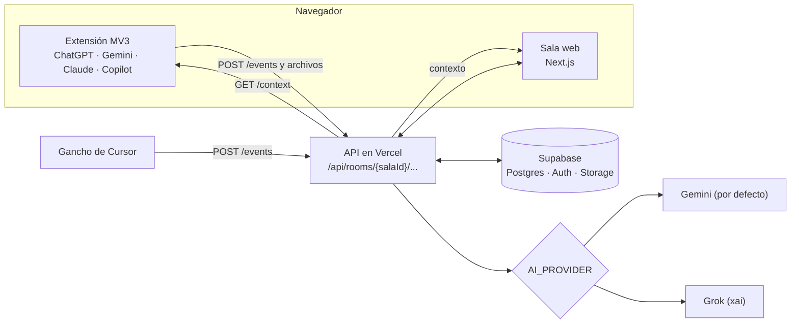
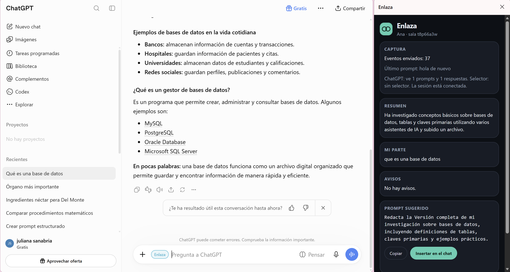
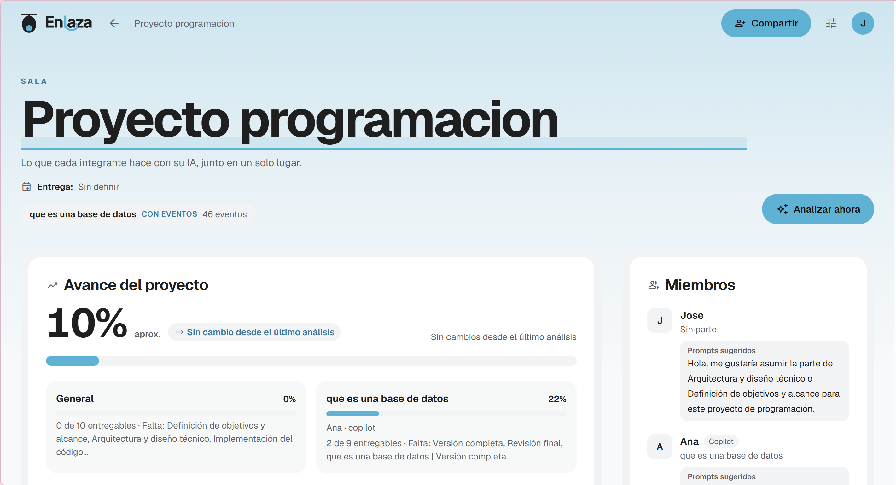
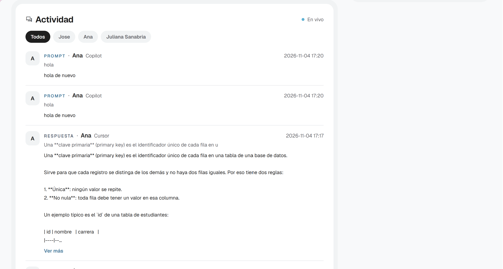
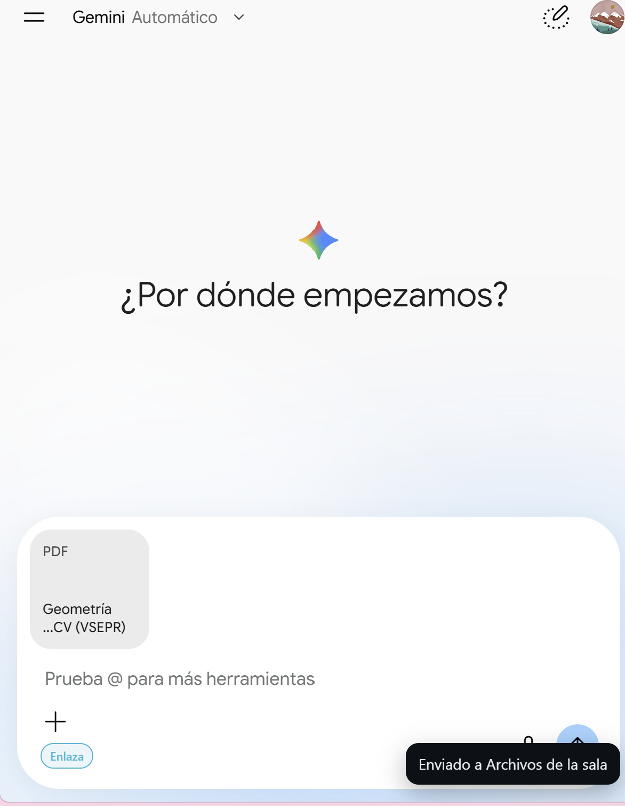

# Enlaza

**Enlaza conecta las IAs de tu equipo para que todos avancen en la misma dirección.**

HackaTOB 2026 · TEC Cartago · 2 al 6 de noviembre · pista The Next Big Thing

- **App en vivo:** [https://enlaza-green.vercel.app](https://enlaza-green.vercel.app)
- **X:** [@enlazaxyz](https://x.com/enlazaxyz)
- **Video:** próximamente

---

## El problema

La inteligencia artificial nos hizo más rápidos trabajando solos, pero más desordenados trabajando en grupo.

Hoy, cuando un equipo hace un proyecto con IA, cada persona trabaja en su propio chat (ChatGPT, Gemini, Claude, Copilot o Cursor), y ninguna IA sabe lo que hacen las demás. Eso se descubre tarde, al unir el trabajo:

- **Trabajo repetido.**
- **Decisiones que se contradicen:** por ejemplo, una persona guarda los datos en JSON y otra en una base de datos.
- **Partes que nadie hizo.**

**Para quién es:** equipos que construyen un proyecto con IA. Gente que hace vibe coding, o un equipo que arma un MVP o un prototipo, cada quien desde su computadora.

### Evidencia

- **El problema es real y está creciendo.**
  - El **78 %** de quienes usan IA en el trabajo lleva su propia herramienta ([Microsoft, 2024](https://www.microsoft.com/en-us/worklab/work-trend-index/ai-at-work-is-here-now-comes-the-hard-part)). Son 31 000 personas en 31 países.
  - Así, en un mismo equipo, cada persona usa una IA distinta que no conoce lo que hacen las demás.
- **Lo que dicen los usuarios:**
  - En el [foro oficial de OpenAI](https://community.openai.com/t/feature-request-collaborative-projects-with-multiple-users-their-personal-chatgpts/1397310/2) piden no tener que «sincronizar a mano» dos conversaciones paralelas.
  - En [Hacker News](https://news.ycombinator.com/item?id=48841133) cuentan que un compañero «había hecho una función idéntica» mientras otro tomaba una decisión contradictoria.
- **Lo que hacen las grandes empresas:** OpenAI ya ofrece [proyectos compartidos](https://academy.openai.com/en/public/clubs/work-users-ynjqu/resources/projects) «en lugar de copiar y pegar entre chats», pero solo dentro de ChatGPT y en planes de pago. **Enlaza funciona entre IAs distintas y es gratis.**
- A nosotros también nos pasó en hackatones anteriores.

**Antes:** cada persona trabaja a ciegas y los errores aparecen al final. **Con Enlaza:** el equipo trabaja en una sala compartida, y una IA analista avisa a tiempo de las contradicciones, el trabajo duplicado y las partes faltantes.

## Qué es

Enlaza es una **sala compartida** para un equipo que arma un proyecto con IAs distintas. Cada persona sigue en su chat. La sala junta lo que hicieron y se lo devuelve al equipo.

El ejemplo: **Josué, Ana, Luis y Sofía** hacen con IA una app para dividir los gastos entre roommates. Josué define el producto, Ana escribe el flujo, Luis programa y Sofía arma la interfaz. Cada uno usa una IA distinta. Enlaza les muestra si se repiten, si se contradicen y qué les falta.

Sirve para **ChatGPT, Gemini, Claude, Copilot y Cursor**.

## Cómo funciona

1. Alguien crea una sala (con inicio de sesión de Google), le pone un tema y una fecha de entrega, y comparte el enlace de invitación.
2. Cada integrante entra con su nombre.
3. En el navegador, la **extensión de Chrome o Edge** lee los prompts y las respuestas que ya terminaron, y puede mandar un archivo o un enlace a Archivos de la sala.
4. En **Cursor** (programa de escritorio), un gancho de Windows manda el prompt y la respuesta del agente. No pasa por la extensión.
5. Todo llega a la sala con `POST /api/rooms/{salaId}/events`. El contrato de los campos está en [CONTRATO.md](CONTRATO.md).
6. Un **analista con IA** (Gemini por defecto; se puede pasar a Grok con `AI_PROVIDER`) lee la sala y arma el contexto de cada miembro: `GET /api/rooms/{salaId}/context`.
7. El panel de la extensión y la página de la sala muestran, en vivo:
   - **Resumen** del trabajo.
   - **Mi parte.**
   - **Avisos:** contradicción, duplicado o falta, con prioridad *Urgente*, *Pronto* o *Puede esperar*.
   - **Avance %** del proyecto y de cada parte.
   - **Prompt sugerido**, para copiar o insertar en el chat.
   - **Actividad:** los prompts y las respuestas.
   - **Archivos:** enlaces y archivos de hasta 10 MB. Si alguien pega un enlace `https` en un prompt, la sala lo guarda solo. Nunca abre ese enlace.



## Capturas

El panel de la extensión, al lado de ChatGPT: resumen, mi parte, avisos y prompt sugerido.



La sala: nombre del proyecto, avance y miembros.



La actividad junta prompts y respuestas de las IAs del equipo. Esta captura es provisional: se va a cambiar. Todavía se ve un prompt repetido y el markdown sin formato.



En Gemini, con un PDF en el compositor, Enlaza avisa que el archivo llegó a la sala.



También están el inicio y la sala en claro y oscuro:

| Inicio | Sala (claro) |
|---|---|
|  |  |

| Sala (oscuro) | Archivos de la sala |
|---|---|
|  |  |

## Empezar

### Extensión (Chrome o Edge)

1. Abrí `chrome://extensions` o `edge://extensions`.
2. Activá el **Modo de desarrollador**.
3. Pulsá **Cargar extensión sin empaquetar** y elegí la carpeta `extension/` de este repo.
4. Recargá las pestañas de ChatGPT, Gemini, Claude o Copilot.
5. En la web, copiá el enlace de invitación de tu sala.
6. Abrí el popup de Enlaza, pegá ese enlace, escribí tu nombre y pulsá **Conectar**.

El enlace se queda solo en el almacenamiento del navegador. Más detalle en [extension/README.md](extension/README.md).

### Cursor (Windows)

En la carpeta `cursor-hook/`, un solo comando instala el gancho. No hace falta Node ni Python. El enlace y el nombre van en el comando; no los dejes escritos en el repo.

```powershell
powershell.exe -NoProfile -ExecutionPolicy Bypass -File .\install.ps1 -Invite "https://enlaza-green.vercel.app/join/TU-SALA?t=TU-TOKEN" -Member "Ana"
```

Los pasos están en [cursor-hook/README.md](cursor-hook/README.md).

### Ver la sala

1. Abrí [https://enlaza-green.vercel.app](https://enlaza-green.vercel.app) e iniciá sesión con Google.
2. Creá una sala o entrá con el enlace que te pasó el equipo.
3. Mirá el avance, los avisos, tu siguiente paso y la actividad.
4. Abrí **Archivos** para ver enlaces y archivos, o agregá uno.
5. **Analizar ahora** vuelve a leer la sala con la IA.

El enlace de una sala de prueba lo da el equipo. No está en este archivo.

## Tecnología

- **Web:** Next.js 16 (App Router) en **Vercel**. Sala, inicio con Google y API.
- **Datos:** **Supabase** (Postgres con RLS, Auth y Storage privado para Archivos).
- **Analista:** **Gemini** en el nivel gratuito. Con `AI_PROVIDER=xai` pasa a Grok, sin cambiar código.
- **Extensión:** Chrome Manifest V3, sin compilar. Content scripts, service worker y panel lateral.

## Correr la web en tu computadora

Necesitás Node 20 o más reciente y un proyecto de Supabase. Los scripts SQL están en `web/supabase/`.

```bash
cd web
npm install
cp ../.env.example .env.local   # y completá los valores
npm run dev
```

Estas son las variables (solo los nombres; las claves no se suben):

| Variable | Para qué sirve |
|---|---|
| `SUPABASE_URL` | URL del proyecto de Supabase |
| `SUPABASE_ANON_KEY` | Clave pública de Supabase |
| `SUPABASE_SERVICE_ROLE_KEY` | Clave de servidor (solo en el servidor) |
| `AI_PROVIDER` | `gemini` (por defecto) o `xai` |
| `GEMINI_API_KEY` | Clave de Google AI Studio |
| `GEMINI_MODEL`, `GEMINI_FALLBACK_MODEL` | Opcionales: modelo principal y de respaldo |
| `XAI_API_KEY` | Solo si `AI_PROVIDER=xai` |

Pruebas: `npm test`, `npm run lint` y `npm run build`. Más detalle en [web/README.md](web/README.md).

## Equipo

- **Jose (Persona A):** plataforma web y analista con IA.
- **Juliana Sanabria ([@julissb51-cell](https://github.com/julissb51-cell)) (Persona B):** extensión, integración con Cursor y presentación.

## Modelo de negocio (propuesta)

> Es una propuesta para la hackathon. Todavía no está validada con clientes.

- **Gratis** para un equipo con una sala.
- **Suscripción mensual** cuando necesitan más salas, más integrantes o más IAs conectadas.

## Riesgos

- **Privacidad de los chats:** la extensión pide consentimiento y solo lee las páginas de las IAs que declara. Las salas son privadas y se entra por invitación. La base tiene reglas de seguridad (RLS). Los archivos van a un almacenamiento privado.
- **Límites del plan gratis de la IA:** hay reintentos y un modelo de respaldo (`GEMINI_FALLBACK_MODEL`). El avance % es una estimación, no una nota.
- **Cambios en las páginas de las IAs:** los selectores están en un archivo por sitio, con alternativas.

## Revisión interna

Recorrimos la app como si fuéramos usuarios y ajustamos lo que encontramos:

- **Fallas del servicio de la IA:** cuando Gemini no respondía, agregamos reintentos automáticos y modelos de respaldo.
- **Alertas que se escapaban:** reforzamos las instrucciones de la IA y sumamos reglas de respaldo para detectar las contradicciones y el trabajo repetido.
- **Textos confusos:** corregimos la gramática y las frases exageradas de los resúmenes.
- **Uso diario:** la sesión se inicia una sola vez, las salas se crean al instante, borrar una sala pide confirmación, se puede invitar por correo, y mejoramos el celular y la barra superior.
- **Seguridad:** solo el dueño puede borrar una sala, las salas de demostración están protegidas y ninguna clave queda en el código público.

## Limitaciones

- La extensión lee ChatGPT, Gemini, Claude y Copilot en el navegador. Si esas páginas cambian, hay que ajustar los selectores.
- Cursor no se captura con la extensión. En Windows se usa el gancho de `cursor-hook/`. Hay scripts de ganchos para Claude Code en `extension/hooks/`, aparte del manifiesto.
- Borrar un archivo pide la sesión de Google de quien lo agregó o del dueño de la sala. El enlace de invitación no alcanza para borrarlo.
- El análisis depende del nivel gratuito de Gemini, que tiene cupo.
- No hay app móvil. La web sí se adapta al celular.

## Hoja de ruta

- Avisos por correo cuando se acerca la fecha de entrega.
- Publicar la extensión en la Chrome Web Store.

---

## English summary

**Enlaza** is a shared room for a team building a product with different AIs (ChatGPT, Gemini, Claude, Copilot, and Cursor): vibe coders, or a group shipping an MVP. A Chrome or Edge extension captures finished prompts and replies, and can send a file or link to the room. Cursor on Windows uses a hook. The room (Next.js on Vercel, Supabase) runs a Gemini analyst, switchable to Grok with `AI_PROVIDER`, and shows each member a summary, warnings, progress, and a suggested prompt. Pitch example: Josué, Ana, Luis, and Sofía build an app to split expenses among roommates. Proposed pricing: free for one team and one room; a monthly subscription when they need more rooms, members, or connected AIs. Live: https://enlaza-green.vercel.app · X: [@enlazaxyz](https://x.com/enlazaxyz)

## Licencia

MIT. El aviso está en [LICENSE](LICENSE). Enlaza está basado en ChatArchive, que también es MIT.
