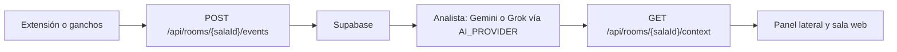

# Enlaza

HackaTOB 2026 · TEC Cartago · 2 al 6 de noviembre · pista The Next Big Thing

**App:** [https://enlaza-green.vercel.app](https://enlaza-green.vercel.app)

**Video de la demo:** [TODO: enlace del video]

## El problema

En un trabajo de la U, cada persona del equipo usa su propia IA. Una escribe el informe en ChatGPT, otra programa en Gemini, otra arma la presentación en Claude. Ninguna de esas IAs ve lo que hicieron las demás, y el equipo se entera tarde de que dos personas hicieron la misma parte o de que se contradicen.

## Qué es

Enlaza es una sala compartida, una extensión de navegador y unos ganchos para el editor.

Cada persona sigue usando su propia IA, con todas sus funciones. Los prompts y las respuestas llegan a la sala. Un analista (Gemini, o Grok si `AI_PROVIDER=xai`) arma un contexto común: marca lo que falta, lo que está duplicado y lo que se contradice, y le deja a cada quien un prompt para seguir.

## Para quién es

Estudiantes universitarios de 18 a 25 años, en grupos de 3 a 5 personas. En el grupo hay un coordinador y el resto son miembros. También sirve para equipos de hackathon.

## Cómo funciona

1. Alguien crea una sala. El id lo elige o se genera solo, y se comparte como código de invitación.
2. Cada persona entra con su nombre. El enlace ya trae el token: `https://enlaza-green.vercel.app/join/{salaId}?t={token}`.
3. En la extensión, la persona pega ese enlace una vez y acepta compartir los prompts y las respuestas de ChatGPT y Gemini.
4. La extensión, o los ganchos de Cursor y Claude Code, mandan cada evento a la sala.
5. Supabase guarda la sala. El analista resume el trabajo.
6. La extensión pide el contexto al conectar y cada 30 segundos. El panel muestra el resumen, los avisos y el prompt sugerido. La sala web muestra lo mismo, en vivo.

Los detalles de datos, endpoints y el orden de corte están en [CONTRATO.md](CONTRATO.md).

## Estructura del repo

- `web/` — app de Next.js (Jose, Persona A). Vercel, Supabase y Gemini en el nivel gratuito como analista. Se cambia a Grok con `AI_PROVIDER=xai`.
- `extension/` — extensión de Chrome Manifest V3 (Juliana Sanabria, Persona B). ChatGPT y Gemini en la web, y ganchos para Cursor y Claude Code.
- `CONTRATO.md` — decisiones ya acordadas y ejemplos en JSON.
- `.env.example` — nombres de las variables. Las claves reales van en `.env` y no se suben.

## Cómo correrlo

La app web está en [web/README.md](web/README.md). En corto, desde `web/`: `npm install`, copiar `../.env.example` a `.env.local` y `npm run dev`. La app publicada es [https://enlaza-green.vercel.app](https://enlaza-green.vercel.app).

La extensión se carga sin empaquetar. Los pasos, la sala de prueba (`demo`, token `token-de-prueba`, nombre Ana) y los ganchos están en [extension/README.md](extension/README.md).

## Equipo

- **Juliana Sanabria (Persona B):** extensión y presentación.
- **Jose (Persona A):** web e IA.

## Licencia

MIT. El aviso está en [LICENSE](LICENSE). Enlaza está basado en ChatArchive, que también es MIT.
