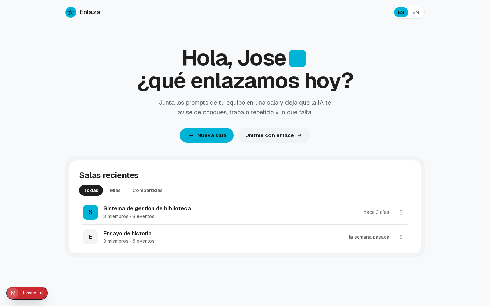
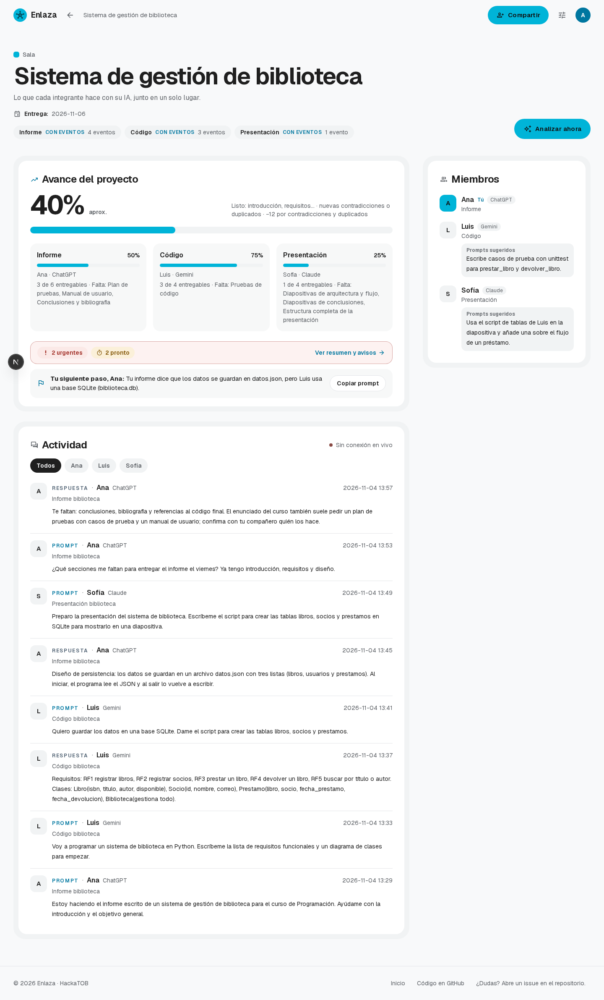
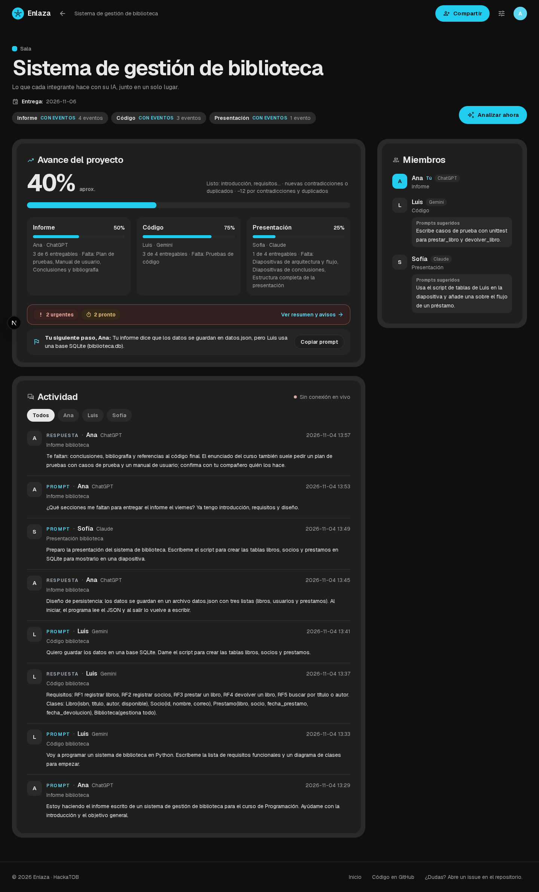
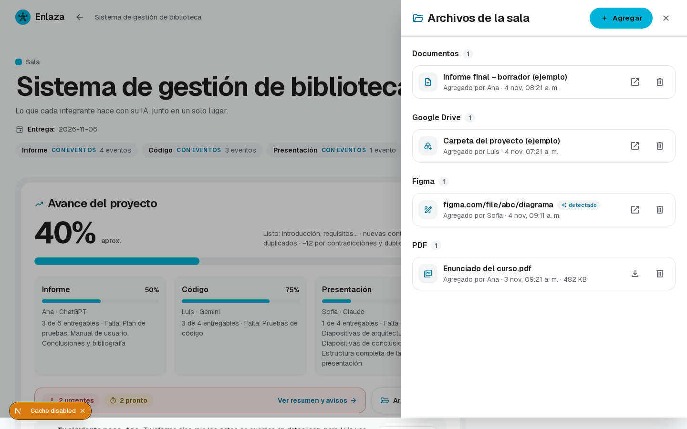
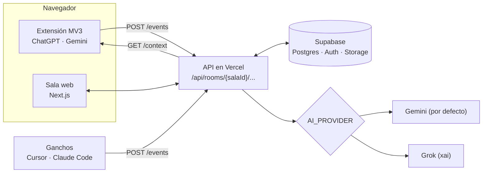

# Enlaza

**Enlaza conecta las IAs de tu equipo para que todos avancen en la misma dirección.**

HackaTOB 2026 · TEC Cartago · 2 al 6 de noviembre · pista The Next Big Thing

- **App en vivo:** [https://enlaza-green.vercel.app](https://enlaza-green.vercel.app)
- **Video de la demo:** [TODO: enlace del video]

---

## El problema

Hoy, cuando un equipo hace un proyecto con IA, cada persona trabaja en su propio chat (ChatGPT, Gemini o Claude), y ninguna IA sabe lo que hacen las demás. Eso trae varios problemas, que se descubren tarde, al unir el trabajo:

- **Trabajo repetido.**
- **Decisiones que se contradicen:** por ejemplo, una persona guarda los datos en JSON y otra en una base de datos.
- **Partes que nadie hizo.**

**Usuario:** estudiantes y equipos pequeños de 2 a 5 personas que hacen proyectos, tareas o hackatones con IA, cada quien desde su computadora.

### Evidencia

- **El problema es real y está creciendo.**
  - El **92 %** de los universitarios ya usa IA ([HEPI, 2025](https://www.hepi.ac.uk/reports/student-generative-ai-survey-2025/)). Son 1041 estudiantes de grado en el Reino Unido, encuestados en diciembre de 2024.
  - El **78 %** de quienes usan IA en el trabajo lleva su propia herramienta ([Microsoft, 2024](https://www.microsoft.com/en-us/worklab/work-trend-index/ai-at-work-is-here-now-comes-the-hard-part)). Son 31 000 personas en 31 países.
  - Así, en un mismo equipo, cada persona usa una IA distinta que no conoce lo que hacen las demás.
- **Lo que dicen los usuarios:**
  - En el [foro oficial de OpenAI](https://community.openai.com/t/feature-request-collaborative-projects-with-multiple-users-their-personal-chatgpts/1397310/2) piden no tener que «sincronizar a mano» dos conversaciones paralelas.
  - En [Hacker News](https://news.ycombinator.com/item?id=48841133) cuentan que un compañero «había hecho una función idéntica» mientras otro tomaba una decisión contradictoria.
- **Lo que hacen las grandes empresas:** OpenAI ya ofrece [proyectos compartidos](https://academy.openai.com/en/public/clubs/work-users-ynjqu/resources/projects) «en lugar de copiar y pegar entre chats», pero solo dentro de ChatGPT y en planes de pago. **Enlaza funciona entre IAs distintas y es gratis.**
- A nosotros también nos pasó en hackatones anteriores.

**Antes:** cada persona trabaja a ciegas y los errores aparecen al final. **Con Enlaza:** el equipo trabaja en una sala compartida, y una IA analista avisa a tiempo de las contradicciones, el trabajo duplicado y las partes faltantes.

## La solución

Enlaza es una **sala compartida** para el equipo, junto con una **extensión de Chrome**. Cada persona sigue usando su IA favorita con todas sus funciones. Lo que pregunta y lo que la IA responde llega a la sala, y un **analista con IA** (Gemini) arma el contexto común:

- **Resumen** del trabajo del equipo.
- **Contradicciones:** por ejemplo, el informe dice JSON y el código usa SQLite.
- **Duplicados:** dos personas haciendo lo mismo.
- **Lo que falta** de cada parte, comparado con lo que pide la entrega.
- **Prioridades:** *Urgente*, *Pronto* y *Puede esperar*.
- **Avance %** del proyecto y de cada parte (Informe, Código, Presentación…).
- **Siguiente prompt sugerido** para cada persona, listo para copiar o insertar en su chat.
- **Archivos de la sala:** enlaces y archivos de hasta 10 MB. Si alguien pega un enlace en un prompt, Enlaza lo guarda solo (nunca lo abre).

## Cómo funciona

1. Alguien crea una sala (con inicio de sesión de Google), le pone un tema y una fecha de entrega, y comparte el enlace de invitación.
2. Cada integrante entra con su nombre.
3. En la extensión, pega el enlace una vez y acepta compartir sus prompts y respuestas de **ChatGPT** y **Gemini**.
4. La extensión manda cada prompt y cada respuesta a la sala (`POST /api/rooms/{salaId}/events`).
5. El analista lee la sala y devuelve el contexto (`GET /api/rooms/{salaId}/context`).
6. El panel lateral de la extensión y la sala web muestran el resumen, los avisos, el avance y el prompt sugerido, en vivo.

Los detalles de datos y endpoints están en [CONTRATO.md](CONTRATO.md).

## Capturas

| Inicio | Sala (claro) |
|---|---|
|  |  |

| Sala (oscuro) | Archivos de la sala |
|---|---|
|  |  |

## Demo en vivo

La sala de demo **`demo-final`** trae un caso real: un **sistema de gestión de biblioteca** hecho por tres personas.

- **Ana** hace el informe en ChatGPT.
- **Luis** programa en Gemini.
- **Sofía** arma la presentación con Claude.

Ahí se ve cómo Enlaza detecta que el informe guarda los datos en `datos.json` mientras el código usa SQLite.

> Los eventos de Sofía (Claude) son **datos precargados** para la demo. La extensión captura en vivo solo ChatGPT y Gemini.

1. Abre [https://enlaza-green.vercel.app](https://enlaza-green.vercel.app) e inicia sesión con Google.
2. Entra a la sala de demo **`demo-final`** con el enlace de invitación que te da el equipo.
3. Mira el **Avance del proyecto** (% general y por parte), los avisos con prioridad y **Tu siguiente paso**. Por ejemplo, el informe dice `datos.json` pero Luis usa SQLite.
4. Abre **Archivos** para ver los enlaces de la sala, o agrega uno nuevo.
5. Pulsa **Analizar ahora** para que Gemini vuelva a leer la sala.
6. Para ver la captura en vivo, instala la extensión (abajo), conéctala con el mismo enlace como **Ana** y escribe un prompt en ChatGPT. Aparece en la actividad de la sala.

## Modelo de negocio (propuesta)

> Es una propuesta para la hackathon. Todavía no está validada con clientes.

- **Gratis para estudiantes y equipos pequeños:** salas con límite de integrantes y de análisis por día.
- **Plan de pago para equipos:** más integrantes, análisis ilimitado, historial más largo y más espacio en Archivos.
- **Plan para universidades:** licencia por curso o por institución, con un panel para docentes que muestra el avance de cada grupo, y soporte.

## Arquitectura

- **Web:** Next.js 16 (App Router) desplegado en **Vercel**. Incluye la sala, el inicio de sesión con Google y la API.
- **Datos:** **Supabase** (Postgres con RLS, Auth y Storage privado para Archivos).
- **Analista:** **Gemini** en el nivel gratuito por defecto. La variable `AI_PROVIDER` permite cambiar a Grok (`xai`) sin tocar código.
- **Extensión:** Chrome Manifest V3. Usa content scripts para ChatGPT y Gemini, un service worker y un panel lateral. También hay ganchos para Cursor y Claude Code.



## Correrlo en tu computadora

Necesitas Node 20 o más reciente y un proyecto de Supabase (los scripts SQL están en `web/supabase/`).

```bash
cd web
npm install
cp ../.env.example .env.local   # y completa los valores
npm run dev
```

Estas son las variables de entorno que necesitas (solo los nombres; las claves nunca se suben al repo):

| Variable | Para qué sirve |
|---|---|
| `SUPABASE_URL` | URL del proyecto de Supabase |
| `SUPABASE_ANON_KEY` | Clave pública de Supabase |
| `SUPABASE_SERVICE_ROLE_KEY` | Clave de servidor de Supabase (solo en el servidor) |
| `AI_PROVIDER` | `gemini` (por defecto) o `xai` |
| `GEMINI_API_KEY` | Clave de Google AI Studio |
| `GEMINI_MODEL`, `GEMINI_FALLBACK_MODEL` | Opcionales: modelo principal y de respaldo |
| `XAI_API_KEY` | Solo si `AI_PROVIDER=xai` |

Pruebas: ejecuta `npm test`, `npm run lint` y `npm run build`. Hay más detalles en [web/README.md](web/README.md).

## Instalar la extensión

1. Abre `chrome://extensions` (o `edge://extensions`).
2. Activa el **Modo de desarrollador**.
3. Pulsa **Cargar extensión sin empaquetar** y elige la carpeta `extension/` de este repo.
4. Recarga las pestañas de ChatGPT y Gemini.
5. Abre el popup de Enlaza, pega el enlace de invitación de la sala, escribe tu nombre y pulsa **Conectar**.

El token queda solo en el almacenamiento local del navegador. Hay más detalles en [extension/README.md](extension/README.md).

## Equipo

- **Jose (Persona A):** web, API, base de datos y analista con IA.
- **Juliana Sanabria ([@julissb51-cell](https://github.com/julissb51-cell)) (Persona B):** extensión de Chrome y presentación.

## Riesgos

- **Privacidad de los chats:**
  - La extensión pide consentimiento y solo captura ChatGPT y Gemini.
  - Las salas son privadas y se entra solo por invitación.
  - La base de datos tiene reglas de seguridad (RLS).
  - Los Archivos se guardan en un almacenamiento privado.
- **Límites del plan gratis de la IA:** los manejamos con reintentos automáticos y modelos de respaldo (`GEMINI_FALLBACK_MODEL`).
- **Cambios en las páginas de las IAs:** pueden afectar la extensión. Los selectores están en un solo archivo por sitio, con alternativas.

## Revisión interna

Recorrimos la app como si fuéramos usuarios y ajustamos lo que encontramos:

- **Fallas del servicio de la IA:** cuando Gemini no respondía, agregamos reintentos automáticos y modelos de respaldo.
- **Alertas que se escapaban:** reforzamos las instrucciones de la IA y sumamos reglas de respaldo para detectar las contradicciones y el trabajo repetido.
- **Textos confusos:** corregimos la gramática y las frases exageradas de los resúmenes.
- **Uso diario:**
  - La sesión se inicia una sola vez.
  - Las salas se crean al instante.
  - Para eliminar una sala se pide confirmación.
  - Se puede invitar por correo.
  - Mejoramos el diseño en el celular y en la barra superior.
- **Seguridad:**
  - Solo el dueño puede borrar una sala.
  - Las salas de demostración están protegidas.
  - Ninguna clave queda en el código público.
- **Pendiente:** la prueba final del equipo en los sitios reales de ChatGPT y Gemini.

## Limitaciones

- La extensión captura solo **ChatGPT** (`chatgpt.com`) y **Gemini** en la web. **Claude en la web no está soportado**. Claude Code y Cursor funcionan solo con los ganchos de Node.
- La extensión todavía no envía archivos a Enlaza. Los archivos se agregan desde la sala web.
- Si ChatGPT o Gemini cambian su página, hay que actualizar los selectores de la extensión.
- El análisis depende del nivel gratuito de Gemini, que tiene límites de uso. El avance % es una estimación de la IA, no una nota.
- Borrar archivos requiere iniciar sesión con Google (solo el dueño de la sala o quien lo agregó).
- No hay app móvil. La web sí se adapta al celular.

## Hoja de ruta

- Botón **«Enviar a Enlaza»** en la extensión, para mandar archivos de ChatGPT y Gemini a la sala.
- Soporte para Claude, Copilot y otras IAs en la web.
- Avisos por correo cuando se acerca la fecha de entrega.
- Panel para docentes y planes por equipo y por universidad.
- Publicar la extensión en la Chrome Web Store.

---

## English summary

**Enlaza** gives a student team one shared context while each member keeps using their own AI. A Chrome extension captures prompts and answers from ChatGPT and Gemini and sends them to a shared room (Next.js on Vercel and Supabase). A Gemini analyst (switchable to Grok with `AI_PROVIDER`) summarizes the work, flags contradictions, duplicates and missing parts, ranks them Urgent / Soon / Can wait, estimates progress, and suggests each member's next prompt. Rooms also hold shared links and files. Evidence: 92% of students use AI (HEPI 2025), 78% of AI users bring their own tools (Microsoft 2024 Work Trend Index), and users in OpenAI's forum and on Hacker News describe manually syncing parallel chats and duplicated, conflicting work. OpenAI's shared projects work only inside ChatGPT on paid plans; Enlaza works across different AIs, for free. Live: https://enlaza-green.vercel.app

## Licencia

MIT. El aviso está en [LICENSE](LICENSE). Enlaza está basado en ChatArchive, que también es MIT.
